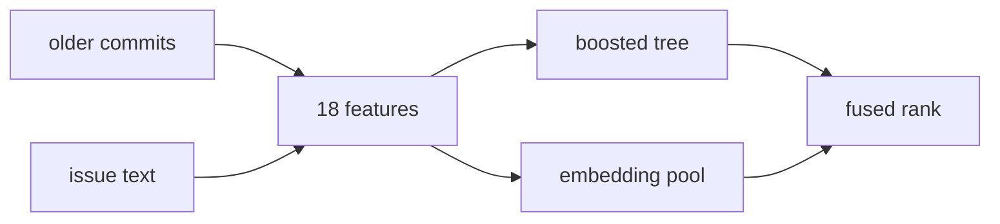

<!-- Generated from docs/README.template.md by `commitcompass readme`. Edit the template, not this file. -->
# CommitCompass

[](https://github.com/VijayChamakuri/commitcompass/actions/workflows/ci.yml) [](https://www.python.org/) [](LICENSE) [](https://vijaychamakuri.github.io/commitcompass/)

A coding agent that opens the wrong file cannot fix the bug. I built CommitCompass to rank the file a bug report should change, training only on git history: the commit message, and the files that commit edited. On SWE-bench Lite, a set of 300 real GitHub issues, that ranker puts the edited file first on 47.7% of issues, against 37.3% for keyword search (BM25, Best Matching 25).

## What I measured



Older commits and the issue text are turned into the same feature row. A gradient-boosted tree scores every file, and a local embedding model reranks a short pool of files. The two ranked lists are combined below.

| Method | Acc@1 | Acc@5 |
|---|---:|---:|
| BM25, whole file | 37.3% | 65.0% |
| Hand-tuned hybrid | 43.0% | 70.0% |
| Commit-supervised reranker | 47.7% | 71.7% |
| Reranker, leave-one-repo-out | 46.0% | 71.0% |
| Reranker fused with Jina-Code | 46.0% | 74.7% |

Acc@k (accuracy at k) is the share of the 300 issues whose edited file is in the top k. The reranker is a gradient-boosted tree trained on commits. Leave-one-repo-out means the tree that scores a repository never trained on that repository.

The commit-trained tree beats BM25 by 10.3 points at Acc@1. Fusing it with a local code-embedding model helps a little at Acc@5, and that gain's interval includes zero. The intervals, the published rows, and the per-repository numbers are in [docs/RESULTS.md](docs/RESULTS.md).

## How it works

### Labels from commits

For each of the 12 repositories, training rows are the last 250 qualifying commits from before that repository's first SWE-bench issue ([`mine.py`](src/commitcompass/mine.py), [`swe_replay.py`](src/commitcompass/swe_replay.py)). The query is the commit message, and the label is the Python files that commit changed. Bots, version bumps, and format-only edits are dropped, which leaves 3,000 queries. [`check_no_label_leak`](src/commitcompass/swe_eval.py#L81-L87) raises if any training commit is not strictly older than the issues in its repository, and no SWE-bench field is used to fit the tree.

### One index, updated by diff

Each repository is replayed in time on one index, from a partial clone that checks out only Python files ([`swe_replay.py`](src/commitcompass/swe_replay.py)). [`merkle.diff`](src/commitcompass/merkle.py#L67-L87) skips a directory whose hash is unchanged, so only added or modified files are read again, and history features use only earlier commits. Across 3,300 snapshots an update re-read 24.2 files and took 491 milliseconds on average. Spot-checks against a full rebuild matched 17/17.

### 18 features, then a tree

[`features.py`](src/commitcompass/features.py) scores every candidate Python file with keyword overlap, the file's path and symbol names, and how recently and how often it changed. A fixed weighted sum of those signals is the hand-tuned hybrid. The learned model is a gradient-boosted tree ([`fit_gbt`](src/commitcompass/swe_eval.py#L50-L54)): one tree sees all 12 repositories, and leave-one-repo-out fits a separate tree that has never seen the repository it scores ([`evaluate`](src/commitcompass/swe_eval.py#L96-L98)).

```python
models = {"pooled": fit_gbt(train), "loro": {}}
for repo in repos:
    models["loro"][repo] = fit_gbt([r for r in train if r.repo != repo])
```

### Embeddings after the sparse pool

A local copy of `jinaai/jina-embeddings-v2-base-code` reranks a short pool, the top 30 files by keyword search together with the top 30 by the hybrid ([`dense.py`](src/commitcompass/dense.py), [`candidate_pool`](src/commitcompass/swe_run.py#L43-L48)). Each pooled file is embedded once, as a short skeleton of its path and signatures, and reciprocal rank fusion combines that score with the tree ([`rrf`](src/commitcompass/swe_eval.py#L57-L65)). The pool holds the gold file on 91.3% of issues, so a file outside it cannot be recovered. On that pool the model reaches Acc@5 65.3%, against a published full-corpus figure of 80.3% for the same model family.

## Design decisions

| Choice | Why | Cost |
|---|---|---|
| Train on commits older than the first issue | The labels are already in git, and the leak guard enforces the time cut | A commit message is written after the edit, and it is shorter than a bug report |
| A tree on named features, beside fixed weights | Permutation importance shows which signal moved the rank | Acc@1 versus the hybrid is +4.7 pts (95% CI -0.7 to +10.3) |
| Merkle updates, checked against a full rebuild | Work follows the diff: 24.2 files re-read per update | The equality check is a sample, 17/17, not every snapshot |
| Embed the pool, then fuse | Training needs no vector for old snapshots | A gold file the pool missed cannot be recovered. Pool recall is 91.3% |
| Acc@k as in the LocAgent table | Measured rows and reported rows use one definition | My BM25 is Acc@1 37.3% and Acc@5 65.0%, against 38.7% and 61.7% reported |

## Evaluation

**Metric.** Acc@k is 1 only when every gold file is inside the top k ([`acc_at`](src/commitcompass/swebench.py#L139-L141)). Gold files are the `.py` paths the reference patch modifies. A file the patch creates is excluded, because it is absent from the base commit.

In [`results/swebench_lite_per_instance.jsonl`](results/swebench_lite_per_instance.jsonl) every one of the 300 issues has a single gold file. Intervals use 2,000 bootstrap resamples ([`bootstrap_ci`](src/commitcompass/metrics.py#L66-L74)), paired across the same issues when two methods are compared.

**Leakage and the index.** The leak guard is an assertion inside the evaluator: it raises when a training commit is not strictly older than the issues in that repository. The incremental index is compared with a from-scratch rebuild on the sampled snapshots above, and the recorded run matched 17/17. On the commit-history benchmark, features are computed before that commit is absorbed into the priors ([`replay_repo`](src/commitcompass/evaluate.py#L62-L72)).

**Tests.** The offline suite is 24 tests.

- [`tests/test_commitbench.py`](tests/test_commitbench.py) (18) builds a synthetic git repo and checks mining filters, tokenization, chunking, the Merkle diff, incremental-index equality, the metric math, the temporal split, and that history priors ignore the query commit and later commits.
- [`tests/test_swebench.py`](tests/test_swebench.py) (5) checks patch parsing, Acc@k, rank fusion, the leak guard, and a history parser that survives control characters inside a commit message.
- [`tests/test_readme.py`](tests/test_readme.py) (1) fails if this page or [docs/RESULTS.md](docs/RESULTS.md) disagrees with a fresh render of `results/`.

`make test` runs ruff, the format check, mypy on `src/`, and these tests. [`.github/workflows/ci.yml`](.github/workflows/ci.yml) runs the same checks on every push, plus a smoke replay of the 3 flask issues (30 training commits, no embeddings).

**Second benchmark.** Commit messages from flask, requests, and httpx, earliest 70% for training and latest 30% for test (1,011 test commits). Recall@10, the share of edited files that land in the top 10, is 0.895 for the tree and 0.849 for BM25. The masked condition and the per-repo tables are in [docs/HISTORY_BENCHMARK.md](docs/HISTORY_BENCHMARK.md).

## Limitations

The output is a ranked list of files. Producing a patch, and running the target project's tests, are outside this repo.

The 300 issues come from 12 Python repositories, and each gold set is one file. Multi-file edits and other languages are unmeasured.

Training text is a commit message, not an issue. Leave-one-repo-out is the transfer number: Acc@1 46.0% and Acc@5 71.0%, against 47.7% and 71.7% when the repository's own history is included.

The embedding step cannot see past the pool. Pool recall is 91.3%, so the other issues are misses for every method that only reorders that pool.

## What I'd do next

1. Fine-tune a small code-embedding model on the same commit labels, using files the tree ranked above the gold file as hard negatives.
2. Hand the top files to an agent at `base_commit`, let it edit, and run the SWE-bench tests. That pass rate is not in this repo.
3. Repeat the file metric on SWE-bench Verified, and on patches that edit more than one file.
4. Put a latency budget on the tree so the rank can run while someone is typing.

## Run it

```bash
git clone https://github.com/VijayChamakuri/commitcompass
cd commitcompass
uv sync --all-groups
make test
```

`make test` needs the dev dependency group, which `uv sync --all-groups` installs. Python 3.12 is the version pinned in [`.python-version`](.python-version).

The SWE-bench command downloads the dataset from the Hugging Face datasets server and clones the 12 repositories from GitHub. No key is required. `--no-dense` skips the embedding model:

```bash
uv run commitcompass swebench --no-dense
```

Wall times stored in [`results/swebench_lite.json`](results/swebench_lite.json) put that command at about 74 minutes. Replay is about 60 minutes across 3,300 snapshots, and evaluation is about 15 minutes. Those two figures are rounded separately.

The embedding pass is about 154 minutes for 10,077 file skeletons.

```bash
make reproduce
```

runs SWE-bench with embeddings, the commit-history benchmark, the site under [`site/`](site), and a fresh copy of this page. The [`Dockerfile`](Dockerfile) runs that same target. Per-issue top-10 lists are on the [explorer](https://vijaychamakuri.github.io/commitcompass/).

## Repo map

- [`swe_eval.py`](src/commitcompass/swe_eval.py) fits the trees, fuses ranks, and writes the metrics.
- [`swe_replay.py`](src/commitcompass/swe_replay.py) replays one repository in time order.
- [`features.py`](src/commitcompass/features.py) builds the 18 features and the fixed-weight scorers.
- [`index.py`](src/commitcompass/index.py) and [`merkle.py`](src/commitcompass/merkle.py) keep BM25 up to date as files change.
- [`dense.py`](src/commitcompass/dense.py) embeds the candidate pool locally.
- [`swebench.py`](src/commitcompass/swebench.py) loads SWE-bench Lite and defines Acc@k.
- [`mine.py`](src/commitcompass/mine.py) turns commits into training queries.
- [`results/`](results) holds the summary files, the per-issue records, and the charts this page is filled from.
- [docs/RESULTS.md](docs/RESULTS.md) holds the long tables. [METHODOLOGY.md](docs/METHODOLOGY.md), [DESIGN_DECISIONS.md](docs/DESIGN_DECISIONS.md), [DATA_CARD.md](docs/DATA_CARD.md), and [HISTORY_BENCHMARK.md](docs/HISTORY_BENCHMARK.md) are next to it.
- [`tests/`](tests) is the offline suite. [`site/`](site) is the GitHub Pages explorer.

This page is generated. Edit [docs/README.template.md](docs/README.template.md) and [docs/RESULTS.template.md](docs/RESULTS.template.md), then run `uv run commitcompass readme`.

## License

The code is MIT ([LICENSE](LICENSE)). Citation fields are in [CITATION.cff](CITATION.cff). SWE-bench is MIT, and each evaluated repository keeps its own license. Reported numbers are copied from LocAgent: Graph-Guided LLM Agents for Code Localization (arXiv:2503.09089), Table 4.
