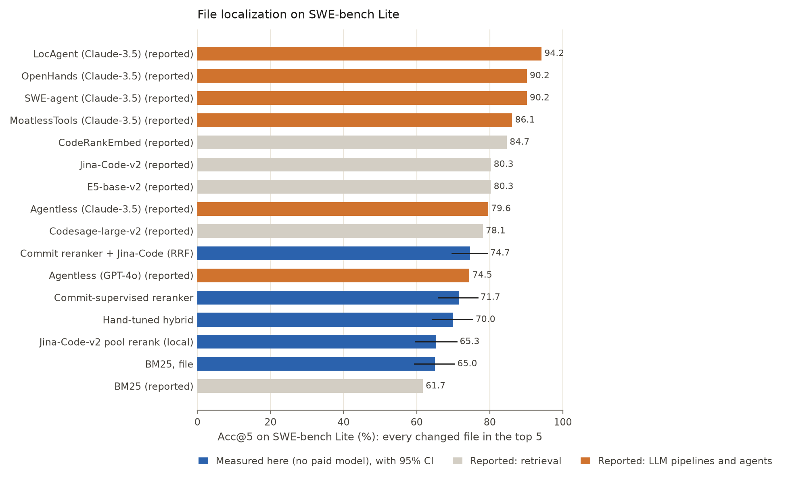
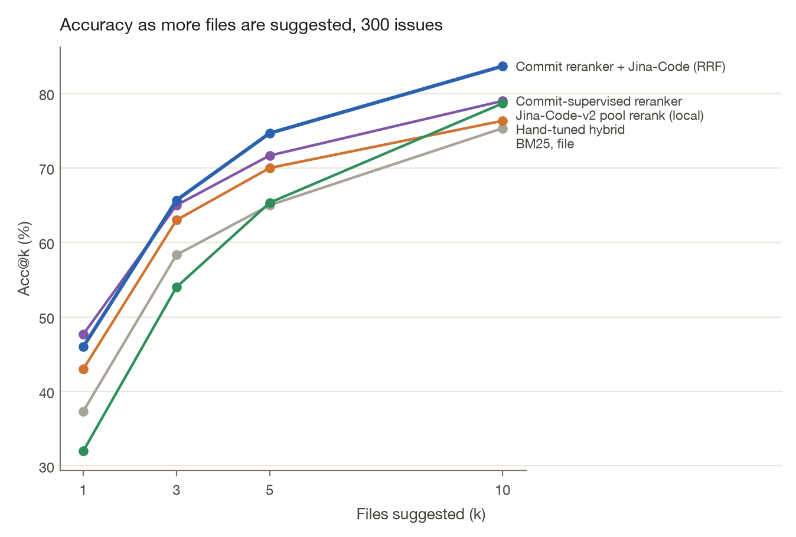
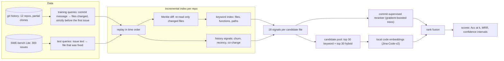
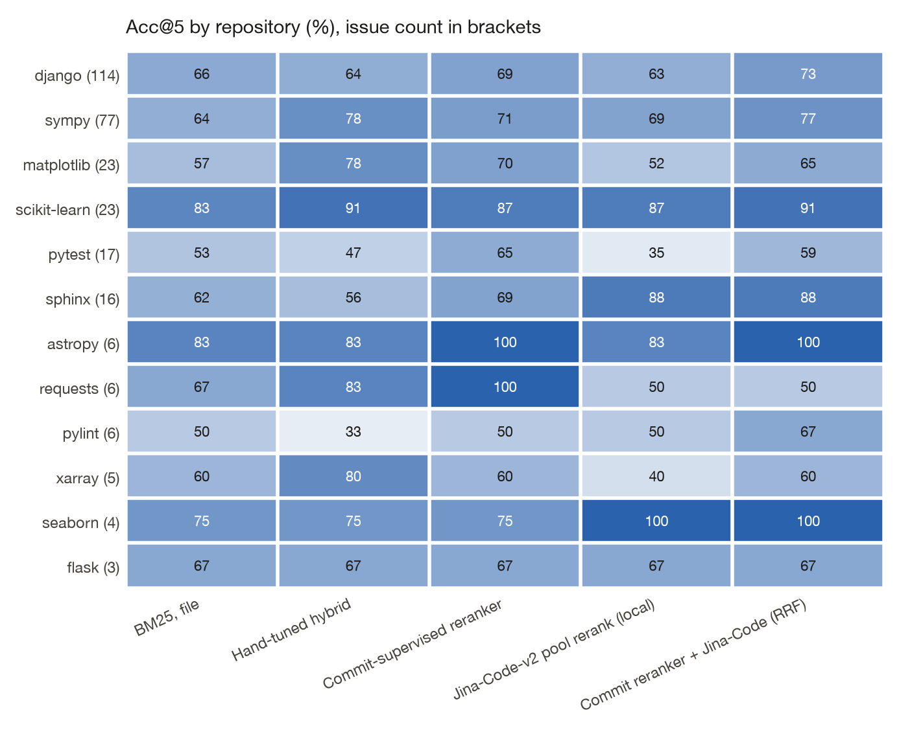

<!-- Generated from docs/README.template.md by `commitcompass readme`. Edit the template, not this file. -->
# CommitCompass

**Points coding agents to the right file, learned from git history.**

**Which files does a coding agent actually need?** A code-localization retriever trained *only* on free supervision from git history (commit message → files changed), evaluated on all 300 SWE-bench Lite issues against published baselines. It runs on a laptop CPU with no API calls.

[](https://github.com/VijayChamakuri/commitcompass/actions/workflows/ci.yml)
[](https://vijaychamakuri.github.io/commitcompass/)

[](https://github.com/astral-sh/ruff)

[](LICENSE)



## In plain English

When an AI coding assistant gets a bug report, its first job is to **find the file it needs to change**. If it opens the wrong file, nothing it writes afterwards can fix the bug.

This project builds a tool for that step and measures it honestly:

- **What it learns from:** a project's own git history. Every past commit already pairs a description ("fix crash when saving empty form") with the files that were changed, so no one has to label training data by hand.
- **How it's tested:** on 300 real GitHub bug reports from **SWE-bench Lite**, the standard benchmark for coding agents, using the same scoring as published research so the numbers can sit side by side.
- **What it found:** it ranks the right file first in **47.7%** of issues, against 37.3% for classic keyword search. Combined with a small code-search model, the right file is in its top 5 picks **74.7%** of the time. All of this runs on a laptop with no paid AI.
- **Where it stands:** the best published systems, which call large paid AI models, still do better (up to 94.2% in the top 5). The comparison is shown below rather than hidden.

## Terms used below

| Term | Meaning |
|---|---|
| **Acc@k** | Share of issues where the file that actually needed fixing is among the tool's top *k* suggestions. Acc@1 means it was the very first suggestion. |
| **BM25** | Classic keyword search, the standard baseline: rank files by how many of the issue's words they contain, weighted by how rare those words are. |
| **Reranker** | A small model that re-orders candidate files using signals like keyword match, file paths, function names and how recently a file changed. |
| **Commit-supervised** | The reranker learns only from past commits (message → files changed), never from the benchmark's answers. |
| **Leave-one-repo-out** | The model scoring a project never saw that project's history, which tests whether it works on a brand-new codebase. |
| **Dense / embeddings** | A neural model that turns code and text into vectors so it can match meaning, not just shared words. Here it's a free model running locally. |
| **RRF** | Reciprocal rank fusion: a simple way to combine two rankings by rewarding files both rank highly. |
| **95% CI** | The range the true score likely falls in, given only 300 test issues. Two results whose ranges overlap a lot may not really differ. |
| **pts** | Percentage points: 37% → 47% is +10 pts. |
| **Incremental index** | When the code changes, only the changed files are re-read, instead of rebuilding the whole search index. |

## Key results

File-level localization on all 300 SWE-bench Lite issues (Acc@k = gold file in the top k, the same definition as the reported rows). All measured on a laptop CPU with no API calls:

- **Git history alone is useful supervision.** The commit-supervised reranker, trained on 3,000 commit messages from before each repository's first issue and never on a SWE-bench label, reaches **Acc@1 47.7%** and Acc@5 71.7%. That is **+10.3 pts (95% CI +5.0 to +15.7) at Acc@1** over BM25, and +6.7 pts (95% CI +3.0 to +10.7) at Acc@5.
- **It transfers to unseen codebases.** With each repository's own history held out (leave-one-repo-out), it still reaches Acc@1 46.0% and Acc@5 71.0%.
- **The baseline is reproduced, not just cited.** Our BM25 gets Acc@1 37.3% against 38.7% reported, and Acc@5 65.0% against 61.7%.
- **Fused with a local code-embedding reranker**, the best measured method (Commit reranker ⊕ Jina-Code (RRF)) reaches **Acc@5 74.7%** (95% CI 69.7–79.3). For context, reported full-corpus dense retrievers reach 80.3–84.7%, and LLM pipelines and agents on paid APIs reach 79.6–94.2%.
- **Where the gain comes from.** Against a hand-tuned hybrid over the same 18 features, the differences are small and not statistically significant: Acc@1 +4.7 pts (95% CI -0.7 to +10.3), Acc@5 +1.7 pts (95% CI -2.3 to +6.0). Most of the lift over BM25 comes from the features themselves (path, symbol, chunk and history signals). Learning their weights from commit history matches careful hand-tuning with no manual effort, and keeps working on repositories it has never seen.
- **Indexing scales with change, not repo size.** 3,300 snapshots replayed through a Merkle-diff incremental index re-read 24.2 files per update on average. Every spot-check matched a full rebuild (17/17).

> Every number above is rendered from [`results/`](results) by `commitcompass readme`; CI fails if the README and results disagree. Reported rows are copied from LocAgent: Graph-Guided LLM Agents for Code Localization (arXiv:2503.09089), Table 4 and marked as such.

## Why this matters

- **Context is the ceiling on agent quality.** If the right file never reaches the prompt, no model fixes the diff. Localization is the step to measure first.
- **Labels are the bottleneck.** Hand-labelled localization data is scarce. Every merged commit already says "this request → these files", so this repo tests whether that free signal is enough.
- **Agents meet codebases that change every commit.** Retrieval has to stay fresh cheaply, and has to be checked so the incremental index never silently drifts from the truth.

## Quickstart

```bash
git clone https://github.com/VijayChamakuri/commitcompass && cd commitcompass
uv sync
uv run commitcompass swebench --no-dense   # 300 issues, keyword + learned methods, ~74 min on a laptop CPU
```

### Reproduce everything

```bash
make reproduce   # SWE-bench Lite (incl. local dense pass) + commit-history benchmark + site + README
```

| Step | Work | Time (Apple M2, 8 GB, CPU only) |
|---|---|---|
| Replay | 3,300 snapshots over 12 blob-less partial clones (sparse `*.py` checkout) | ~60 min |
| Dense | 10,077 file versions embedded with `jina-embeddings-v2-base-code` (fastembed, ONNX) | ~154 min |
| Evaluate | rerankers (pooled + 12 leave-one-repo-out), bootstrap CIs, charts | ~15 min |

There are no API keys or paid services. Data: SWE-bench Lite via the Hugging Face datasets server; repositories from GitHub.

## Leaderboard

| Method | Source | Acc@1 | Acc@3 | Acc@5 | Acc@10 | MRR |
|---|---|---:|---:|---:|---:|---:|
| **Commit reranker ⊕ Jina-Code (RRF)** | measured here | 46.0 <sub>[40.3, 51.7]</sub> | 65.7 <sub>[60.3, 71.0]</sub> | 74.7 <sub>[69.7, 79.3]</sub> | 83.7 | 0.586 |
| BM25 ⊕ Jina-Code (RRF) | measured here | 43.0 <sub>[37.3, 48.7]</sub> | 63.7 <sub>[58.0, 69.3]</sub> | 73.3 <sub>[68.3, 78.3]</sub> | 80.3 | 0.561 |
| Commit-supervised reranker | measured here | 47.7 <sub>[42.0, 53.7]</sub> | 65.0 <sub>[59.3, 70.3]</sub> | 71.7 <sub>[66.0, 76.7]</sub> | 79.0 | 0.587 |
| Commit reranker, leave-one-repo-out | measured here | 46.0 <sub>[40.7, 51.7]</sub> | 64.3 <sub>[58.7, 69.7]</sub> | 71.0 <sub>[65.7, 76.3]</sub> | 79.3 | 0.573 |
| Hand-tuned hybrid | measured here | 43.0 <sub>[37.3, 48.3]</sub> | 63.0 <sub>[57.3, 68.0]</sub> | 70.0 <sub>[64.3, 75.3]</sub> | 76.3 | 0.551 |
| Jina-Code-v2 pool rerank (local) | measured here | 32.0 <sub>[26.7, 37.7]</sub> | 54.0 <sub>[48.3, 59.7]</sub> | 65.3 <sub>[59.7, 71.0]</sub> | 78.7 | 0.469 |
| BM25, file | measured here | 37.3 <sub>[32.0, 42.7]</sub> | 58.3 <sub>[52.7, 64.0]</sub> | 65.0 <sub>[59.3, 70.3]</sub> | 75.3 | 0.507 |
| BM25, chunk-max | measured here | 35.3 <sub>[30.0, 41.0]</sub> | 57.0 <sub>[51.3, 62.7]</sub> | 65.0 <sub>[59.7, 70.3]</sub> | 72.3 | 0.489 |
| BM25 | reported, sparse retrieval | 38.7 | 51.8 | 61.7 | – | – |
| E5-base-v2 | reported, dense retrieval | 49.6 | 74.5 | 80.3 | – | – |
| Jina-Code-v2 | reported, dense retrieval | 43.4 | 71.2 | 80.3 | – | – |
| Codesage-large-v2 | reported, dense retrieval | 47.8 | 69.3 | 78.1 | – | – |
| CodeRankEmbed | reported, dense retrieval | 52.5 | 77.7 | 84.7 | – | – |
| Agentless (GPT-4o) | reported, LLM pipeline | 67.2 | 74.5 | 74.5 | – | – |
| Agentless (Claude-3.5) | reported, LLM pipeline | 72.6 | 79.2 | 79.6 | – | – |
| SWE-agent (Claude-3.5) | reported, LLM agent | 77.4 | 87.2 | 90.2 | – | – |
| OpenHands (Claude-3.5) | reported, LLM agent | 76.3 | 89.8 | 90.2 | – | – |
| MoatlessTools (Claude-3.5) | reported, LLM agent | 72.6 | 85.8 | 86.1 | – | – |
| LocAgent (Claude-3.5) | reported, LLM agent | 77.7 | 92.0 | 94.2 | – | – |

<sub>Measured rows show the mean and a 95% bootstrap CI over 300 issues. Reported rows come from LocAgent: Graph-Guided LLM Agents for Code Localization (arXiv:2503.09089), Table 4 and were not re-run. LLM rows use paid APIs; nothing here does.</sub>



## How it works



| Module | Responsibility |
|---|---|
| [`swebench.py`](src/commitcompass/swebench.py) | fetch + checksum SWE-bench Lite, parse gold files from patches, Acc@k |
| [`swe_replay.py`](src/commitcompass/swe_replay.py) | per-repo time-ordered replay, sparse checkout, history priors, index verification |
| [`index.py`](src/commitcompass/index.py) · [`merkle.py`](src/commitcompass/merkle.py) | mutable BM25 (file + chunk), Merkle diff, incremental update |
| [`features.py`](src/commitcompass/features.py) | 18 named features and the non-learned retrievers |
| [`dense.py`](src/commitcompass/dense.py) | local code embeddings over a candidate pool, cached per blob |
| [`swe_eval.py`](src/commitcompass/swe_eval.py) | reranker training (pooled, leave-one-repo-out), label-leak guard, fusion, CIs, miss analysis |

## Results in depth

### Does git-history supervision transfer?

- **Commit-supervised reranker vs BM25:** Acc@1 +10.3 pts (95% CI +5.0 to +15.7); Acc@5 +6.7 pts (95% CI +3.0 to +10.7); leave-one-repo-out vs BM25 at Acc@5: +6.0 pts (95% CI +3.0 to +9.3).
- **vs the hand-tuned hybrid** (same features, weights set by hand): Acc@1 +4.7 pts (95% CI -0.7 to +10.3); Acc@5 +1.7 pts (95% CI -2.3 to +6.0).
- **Leave-one-repo-out** (never saw the scored repo's history): Acc@5 71.0% vs 71.7% pooled.
- **Most important features** (permutation importance): `bm25_file_rrank`, `bm25_chunk_norm`, `recency_log_days`, `bm25_chunk`, `symbol_exact`, `path_frac`.

### Dense retrieval and fusion

The local Jina-Code-v2 model reranks a candidate pool: the union of the top 30 files by BM25 and the top 30 by the hand-tuned hybrid, both non-learned. The pool contains the gold file for **91.3%** of issues, which caps any method that only reorders it.

- **Jina-Code-v2 alone:** Acc@5 65.3% (reported full-corpus number: 80.3%).
- **Fused with the commit-supervised reranker (RRF):** Acc@5 74.7%, which is +3.0 pts (95% CI -0.7 to +7.0) over the reranker alone and +9.3 pts (95% CI +5.0 to +13.7) over dense alone.

### Per repository (Acc@5)

| Repository | Issues | BM25, file | Commit-supervised reranker | Jina-Code-v2 pool rerank (local) | Commit reranker ⊕ Jina-Code (RRF) |
|---|---:|---:|---:|---:|---:|
| django/django | 114 | 65.8 | 69.3 | 63.2 | 72.8 |
| sympy/sympy | 77 | 63.6 | 71.4 | 68.8 | 76.6 |
| matplotlib/matplotlib | 23 | 56.5 | 69.6 | 52.2 | 65.2 |
| scikit-learn/scikit-learn | 23 | 82.6 | 87.0 | 87.0 | 91.3 |
| pytest-dev/pytest | 17 | 52.9 | 64.7 | 35.3 | 58.8 |
| sphinx-doc/sphinx | 16 | 62.5 | 68.8 | 87.5 | 87.5 |
| astropy/astropy | 6 | 83.3 | 100.0 | 83.3 | 100.0 |
| psf/requests | 6 | 66.7 | 100.0 | 50.0 | 50.0 |
| pylint-dev/pylint | 6 | 50.0 | 50.0 | 50.0 | 66.7 |
| pydata/xarray | 5 | 60.0 | 60.0 | 40.0 | 60.0 |
| mwaskom/seaborn | 4 | 75.0 | 75.0 | 100.0 | 100.0 |
| pallets/flask | 3 | 66.7 | 66.7 | 66.7 | 66.7 |



### Where it still fails

| Why Commit reranker ⊕ Jina-Code (RRF) missed at k=5 | Issues | Examples |
|---|---:|---|
| issue names a symbol defined in the gold file | 28 | `django__django-10924`, `django__django-11049`, `django__django-11564` |
| vocabulary gap (gold not in BM25 top 50) | 17 | `django__django-11797`, `django__django-12113`, `django__django-16400` |
| gold file named in issue, still missed | 14 | `django__django-12308`, `django__django-13158`, `django__django-13220` |
| lexically reachable but out-ranked | 11 | `django__django-10914`, `django__django-12470`, `django__django-15388` |
| near miss (ranked 6-10) | 6 | `django__django-13033`, `psf__requests-2674`, `scikit-learn__scikit-learn-13584` |

Browse all 300 issues, with our top 10 files and the gold file highlighted, in the [live explorer](https://vijaychamakuri.github.io/commitcompass/).

### Reproducing the baselines

Our BM25 reaches Acc@1 37.3% and Acc@5 65.0%, against 38.7% and 61.7% reported. Implementations differ in tokenisation (ours splits camelCase and snake_case and indexes path tokens), in document unit (whole file vs chunks) and in issue preprocessing. The gap is reported, not tuned away. The dense row differs further by design: it reranks a pool with file skeletons rather than retrieving chunks from the full corpus, because full-corpus chunk embedding of 45k file versions is days of laptop CPU (see [ADR-5](docs/DESIGN_DECISIONS.md)).

### Efficiency

| | |
|---|---|
| Snapshots replayed | 3,300 |
| Largest first full index build | 12.7 s (django: 9.3 s for ~2,578 files) |
| Incremental update | 491 ms per snapshot on average, re-reading 24.2 files |
| Incremental == full rebuild | 17/17 spot-checks |
| Feature computation | 25 ms per query (all candidate files) |

### Secondary benchmark: commit history (flask, requests, httpx)

| Method | Recall@10 | MRR | Recall@10 (file names masked) | MRR (masked) |
|---|---:|---:|---:|---:|
| BM25 (file) | 0.849 | 0.642 | 0.820 | 0.609 |
| Hand-tuned hybrid | 0.893 | 0.725 | 0.855 | 0.650 |
| Commit-supervised reranker | 0.895 | 0.731 | 0.867 | 0.688 |

<sub>1,011 test commits (the latest 30% of each repo's history). "Masked" removes words that literally name a gold file. Full report: [docs/HISTORY_BENCHMARK.md](docs/HISTORY_BENCHMARK.md).</sub>

## Limitations

- **Retrieval is not agent success.** No patches are generated or tested here.
- **Twelve Python repositories.** SWE-bench Lite also has single-file gold, so multi-file localization is untested.
- **Training queries are commit messages, not issues.** They're written after the change and are terser. Leave-one-repo-out quantifies the transfer cost.
- **Dense is pool-limited.** It can't recover a gold file the sparse pool missed.

## Roadmap

1. Hard-negative fine-tuning of a small code-embedding model on the same commit-history labels.
2. Downstream agent success: retrieve top-k at the base commit, let an agent edit, run the SWE-bench tests.
3. SWE-bench Verified and multi-file instances; non-Python repositories.
4. Query-time latency budget: early-exit reranking for interactive use.

## Project structure

```
src/commitcompass/   swebench, swe_replay, swe_eval, dense, index, merkle, features, history, mine, site, readme
results/           every number in this README (JSON, per-instance JSONL, charts)
docs/              METHODOLOGY · DATA_CARD · DESIGN_DECISIONS · HISTORY_BENCHMARK · README template
site/              GitHub Pages: leaderboard + per-instance explorer
tests/             offline tests on a synthetic git repo, metric/parsing/leak guards, README drift
```

## Citation and licence

Code is MIT-licensed ([LICENSE](LICENSE)); cite via [CITATION.cff](CITATION.cff). SWE-bench is MIT-licensed; each evaluated repository keeps its own licence. Reported baseline numbers: LocAgent: Graph-Guided LLM Agents for Code Localization (arXiv:2503.09089), Table 4.
