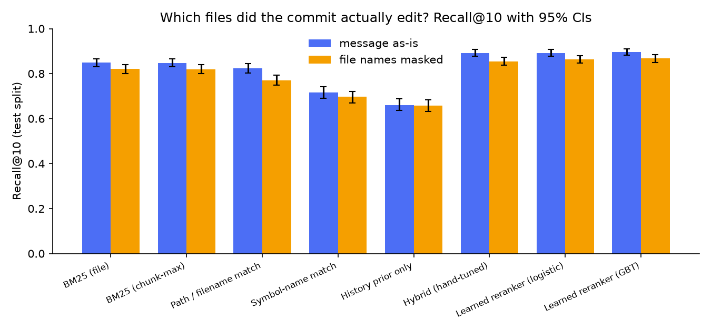
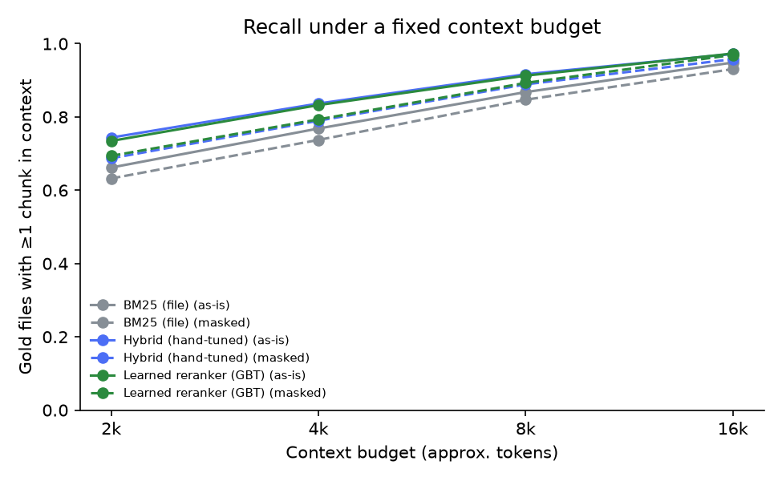

# commitcompass report

_Auto-generated by `commitcompass report` from `results/summary.json`. Every number below comes from that run._

**Setup.** Real commits from flask, requests, httpx up to 2026-10-01. Query = commit message,
gold = existing `.py` files the commit modified. Each query is scored against the repo **as it was at the
parent commit**. Temporal split per repo: earliest 70% of queries train the learned rerankers, latest 30% test
(n_train=2356, n_test=1011). All numbers are on the **test split**; brackets are
95% bootstrap CIs over queries.

## Dataset

| Repo | Commits scanned | Queries kept | Kept | Mean gold files | New files excluded from gold |
|---|---|---|---|---|---|
| flask | 3825 | 1253 | 33% | 1.73 | 114 |
| requests | 4883 | 1488 | 30% | 1.38 | 38 |
| httpx | 1482 | 626 | 42% | 2.55 | 91 |

Drop reasons (all repos): no_modified_py 4131, short_message 1989, bot_author 362, too_many_files 145, typo_or_format 112, version_or_release 81, root_commit 3.

Mean candidate files per query: **67** (every `.py` file in the snapshot). A random ranker would score Recall@10 ≈ **0.170**.

## Results — commit message as-is

| Method | recall@1 | recall@5 | recall@10 | mrr | ndcg@10 | budget_recall@8k |
|---|---|---|---|---|---|---|
| BM25 (file) | 0.335 | 0.722 | 0.849 [0.832, 0.866] | 0.642 [0.621, 0.665] | 0.658 | 0.868 |
| BM25 (chunk-max) | 0.344 | 0.733 | 0.848 [0.830, 0.866] | 0.650 [0.628, 0.673] | 0.666 | 0.882 |
| Path / filename match | 0.295 | 0.682 | 0.824 [0.803, 0.844] | 0.591 [0.569, 0.614] | 0.615 | 0.862 |
| Symbol-name match | 0.184 | 0.488 | 0.716 [0.692, 0.742] | 0.446 [0.423, 0.468] | 0.466 | 0.795 |
| History prior only | 0.133 | 0.472 | 0.660 [0.637, 0.687] | 0.407 [0.384, 0.428] | 0.422 | 0.707 |
| Hybrid (hand-tuned) | 0.412 | **0.796** | 0.893 [0.878, 0.907] | 0.725 [0.703, 0.746] | 0.732 | 0.917 |
| Learned reranker (logistic) | 0.411 | 0.782 | 0.893 [0.878, 0.909] | 0.727 [0.708, 0.747] | 0.730 | **0.917** |
| Learned reranker (GBT) | **0.422** | 0.786 | **0.895 [0.881, 0.910]** | **0.731 [0.710, 0.752]** | **0.735** | 0.913 |

`budget_recall@8k` = share of gold files with at least one chunk packed into an ~8k-token context when chunks
are taken in the method's ranked order.

## Results — file names masked

23% of test commit messages literally name a gold file
(e.g. “sessions.py: …”). Masking removes those words to measure retrieval without the free hint.

| Method | recall@1 | recall@5 | recall@10 | mrr | ndcg@10 | budget_recall@8k |
|---|---|---|---|---|---|---|
| BM25 (file) | 0.307 | 0.690 | 0.820 [0.799, 0.840] | 0.609 [0.587, 0.632] | 0.625 | 0.847 |
| BM25 (chunk-max) | 0.316 | 0.695 | 0.820 [0.800, 0.840] | 0.616 [0.593, 0.639] | 0.632 | 0.857 |
| Path / filename match | 0.191 | 0.599 | 0.771 [0.748, 0.793] | 0.473 [0.451, 0.494] | 0.518 | 0.824 |
| Symbol-name match | 0.175 | 0.470 | 0.696 [0.669, 0.721] | 0.428 [0.405, 0.451] | 0.449 | 0.779 |
| History prior only | 0.128 | 0.463 | 0.657 [0.633, 0.684] | 0.399 [0.378, 0.421] | 0.416 | 0.699 |
| Hybrid (hand-tuned) | 0.337 | **0.742** | 0.855 [0.838, 0.873] | 0.650 [0.628, 0.672] | 0.664 | 0.889 |
| Learned reranker (logistic) | 0.371 | 0.739 | 0.863 [0.846, 0.880] | 0.682 [0.661, 0.704] | 0.688 | **0.894** |
| Learned reranker (GBT) | **0.385** | 0.741 | **0.867 [0.850, 0.883]** | **0.688 [0.667, 0.710]** | **0.693** | 0.893 |

## Is the learned reranker really better?

Paired bootstrap over the same test queries (message as-is):

| Comparison | Mean Δ | 95% CI (paired bootstrap) |
|---|---|---|
| GBT − BM25 (file), recall@10 | +0.046 | [+0.031, +0.063] |
| GBT − BM25 (file), mrr | +0.089 | [+0.072, +0.105] |
| GBT − BM25 (file), budget_recall@8k | +0.045 | [+0.031, +0.060] |
| GBT − Hybrid (hand-tuned), recall@10 | +0.003 | [-0.008, +0.015] |
| GBT − Hybrid (hand-tuned), mrr | +0.006 | [-0.008, +0.020] |
| GBT − Hybrid (hand-tuned), budget_recall@8k | -0.004 | [-0.016, +0.007] |

Masked:

| Comparison | Mean Δ | 95% CI (paired bootstrap) |
|---|---|---|
| GBT − BM25 (file), recall@10 | +0.047 | [+0.031, +0.064] |
| GBT − BM25 (file), mrr | +0.079 | [+0.062, +0.097] |
| GBT − BM25 (file), budget_recall@8k | +0.046 | [+0.029, +0.063] |
| GBT − Hybrid (hand-tuned), recall@10 | +0.012 | [+0.001, +0.024] |
| GBT − Hybrid (hand-tuned), mrr | +0.039 | [+0.025, +0.054] |
| GBT − Hybrid (hand-tuned), budget_recall@8k | +0.004 | [-0.007, +0.016] |

## Per repo (as-is, Recall@10 / MRR)

| Method | flask R@10 / MRR (n=376) | requests R@10 / MRR (n=447) | httpx R@10 / MRR (n=188) |
|---|---|---|---|
| BM25 (file) | 0.845 / 0.680 | 0.861 / 0.590 | 0.828 / 0.691 |
| BM25 (chunk-max) | 0.846 / 0.693 | 0.859 / 0.601 | 0.827 / 0.680 |
| Path / filename match | 0.835 / 0.625 | 0.833 / 0.517 | 0.782 / 0.700 |
| Symbol-name match | 0.701 / 0.488 | 0.757 / 0.391 | 0.650 / 0.492 |
| History prior only | 0.633 / 0.419 | 0.786 / 0.429 | 0.417 / 0.333 |
| Hybrid (hand-tuned) | 0.898 / 0.766 | 0.906 / 0.670 | 0.849 / 0.773 |
| Learned reranker (logistic) | 0.882 / 0.754 | 0.917 / 0.689 | 0.855 / 0.763 |
| Learned reranker (GBT) | 0.887 / 0.753 | 0.916 / 0.692 | 0.862 / 0.780 |

## What the learned reranker relies on

Permutation importance (drop in average precision when a feature is shuffled), test split.

- As-is: `bm25_chunk_norm` 0.216, `bm25_file_rrank` 0.135, `path_frac` 0.054, `bm25_chunk` 0.051, `recency_log_days` 0.041, `bm25_file` 0.022
- Masked: `bm25_chunk_norm` 0.206, `bm25_file_rrank` 0.117, `recency_log_days` 0.038, `bm25_chunk` 0.030, `churn_log` 0.019, `query_mentions_test` 0.016

## Incremental indexing (Merkle tree)

The index is moved from one parent snapshot to the next by diffing Merkle trees (leaf = git blob id,
directory = hash of children). Only changed files are re-read and re-tokenized. Sampled snapshots were also
rebuilt from scratch and compared field-by-field with the incremental index.

| Repo | Queries replayed | Mean full rebuild | Mean incremental update | Speed-up | Files re-indexed / update | Merkle nodes visited | Incremental == full rebuild |
|---|---|---|---|---|---|---|---|
| flask | 1253 | 147 ms (64 files) | 28.6 ms | 5× | 5.14 | 37.5% of tree | 15/15 snapshots |
| requests | 1488 | 176 ms (63 files) | 18.5 ms | 9× | 3.38 | 27.6% of tree | 15/15 snapshots |
| httpx | 626 | 149 ms (59 files) | 21.0 ms | 7× | 4.73 | 55.9% of tree | 15/15 snapshots |

## Failure analysis (learned GBT, test split, as-is)

A *miss* = no gold file in the Learned reranker (GBT)'s top 10 (message as-is). 48 of 1011 test queries (4.7%) are misses.

| Category (first rule that matches) | Misses | Share of misses | Miss rate within category |
|---|---|---|---|
| Cross-cutting change (≥4 gold files) | 0 | 0% | 0% (of 83) |
| Gold file rarely touched before (≤2 prior edits) | 5 | 10% | 38% (of 13) |
| Only test files changed | 9 | 19% | 6% (of 148) |
| Vague message (<6 distinct content tokens) | 23 | 48% | 10% (of 242) |
| Vocabulary mismatch (none of the above) | 11 | 23% | 2% (of 525) |

**Concrete misses (real commits):**

- **Vocabulary mismatch (none of the above)** — `flask@d362399e7e`: “:fire: Remove code supposed to be removed at v1.0”  
  gold: `flask/__init__.py` · top-3 predicted: `tests/test_regression.py`, `flask/helpers.py`, `flask/app.py`
- **Vague message (<6 distinct content tokens)** — `flask@205c943ded`: “Fix misplaced paren in docs”  
  gold: `flask/ctx.py` · top-3 predicted: `flask/helpers.py`, `tests/test_basic.py`, `flask/app.py`
- **Only test files changed** — `flask@0ee1b0b5d9`: “remove test relying on Werkzeug Local internals”  
  gold: `tests/test_regression.py` · top-3 predicted: `tests/test_basic.py`, `tests/test_blueprints.py`, `tests/test_user_error_handler.py`
- **Gold file rarely touched before (≤2 prior edits)** — `flask@afc907fd0d`: “use _typeshed.wsgi instead of wsgiref.types”  
  gold: `src/flask/typing.py` · top-3 predicted: `src/flask/app.py`, `src/flask/helpers.py`, `src/flask/ctx.py`

## Charts

