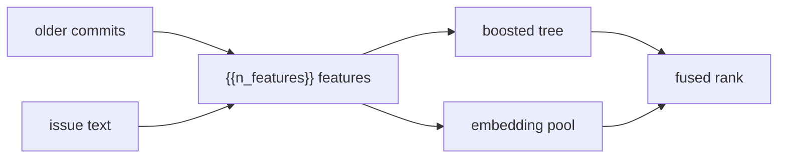

<!-- Generated from docs/README.template.md by `commitcompass readme`. Edit the template, not this file. -->
# CommitCompass

[](https://github.com/VijayChamakuri/commitcompass/actions/workflows/ci.yml) [](https://www.python.org/) [](LICENSE) [](https://vijaychamakuri.github.io/commitcompass/)

A coding agent that opens the wrong file cannot fix the bug. I built CommitCompass to rank the file a bug report should change, training only on git history: the commit message, and the files that commit edited. On SWE-bench Lite, a set of {{n_test}} real GitHub issues, that ranker puts the edited file first on {{rr_acc1}}% of issues, against {{bm25_acc1}}% for keyword search (BM25, Best Matching 25).

## What I measured



Older commits and the issue text are turned into the same feature row. A gradient-boosted tree scores every file, and a local embedding model reranks a short pool of files. The two ranked lists are combined below.

| Method | Acc@1 | Acc@5 |
|---|---:|---:|
| BM25, whole file | {{bm25_acc1}}% | {{bm25_acc5}}% |
| Hand-tuned hybrid | {{hyb_acc1}}% | {{hyb_acc5}}% |
| Commit-supervised reranker | {{rr_acc1}}% | {{rr_acc5}}% |
| Reranker, leave-one-repo-out | {{loro_acc1}}% | {{loro_acc5}}% |
| Reranker fused with Jina-Code | {{fused_acc1}}% | {{fused_acc5}}% |

Acc@k (accuracy at k) is the share of the {{n_test}} issues whose edited file is in the top k. The reranker is a gradient-boosted tree. Leave-one-repo-out means the tree that scores a repository never trained on it.

Jina-Code is a local code-embedding model, combined by reciprocal rank fusion (RRF). Differences below are in percentage points (pts), with a 95% confidence interval (CI).

The highest Acc@5 I measured is {{best_label}}, at {{best_acc5}}% (95% CI {{best_acc5_ci}}). The tree alone is ahead at Acc@1: {{rr_acc1}}% against {{fused_acc1}}% fused. Its gain over BM25 at Acc@1 is {{d_rr_bm25_acc1}}.

Fusion's gain over the tree at Acc@5 is {{d_fused_rr_acc5}}, and that interval includes zero. The long table, published rows, and per-repository numbers are in [docs/RESULTS.md](docs/RESULTS.md).

## How it works

### Labels from commits

For each of the {{n_repos}} repositories I keep the last 250 commits that pass the filters in [`mine.py`](src/commitcompass/mine.py), and only commits older than that repository's first SWE-bench issue. The cap is `TRAIN_PER_REPO` in [`swe_replay.py`](src/commitcompass/swe_replay.py). The query is the commit message, with git trailers stripped and the text cut at 1,500 characters. The label is the existing `.py` files the commit modified.

Bots, version bumps, format-only subjects, messages under 5 words, and commits that touch more than 8 Python files are dropped. That leaves {{n_train}} training queries. [`check_no_label_leak`](src/commitcompass/swe_eval.py#L81-L87) raises if a training commit is not strictly older than every issue in its repository. No SWE-bench field is used to fit the tree.

### One index, updated by diff

Each repository is a partial clone (`--filter=blob:none`) sparse-checked-out to `*.py`. Events for that repository run in time order on one index. [`merkle.diff`](src/commitcompass/merkle.py#L67-L87) skips a subtree whose hash is unchanged, and only added or modified files are tokenized again.

History features (how often a file changes, how long since the last edit, which files change together) absorb only commits with an earlier timestamp than the event being scored. The commit being scored stays out of its own history features.

The recorded replay covers {{events}} snapshots. An incremental update re-read {{reindexed}} files and took {{incr_ms}} ms on average. On a test event at every 25th step of the replay, the index is rebuilt from scratch and compared. Those checks matched {{verified}}.

### {{n_features}} features, then a tree

[`features.py`](src/commitcompass/features.py) builds one row per candidate `.py` file. Sparse scores are BM25 on the whole file and on its best chunk. Name scores are path overlap, the file stem, and symbols defined in the file. The rest are history (churn, recency, co-change), test-file flags, and log file length.

Chunks follow `def` and `class` boundaries ([`chunk.py`](src/commitcompass/chunk.py)). Tokens split `camelCase` and `snake_case`, keep the whole identifier, and drop stopwords ([`textproc.py`](src/commitcompass/textproc.py)).

The hand-tuned hybrid is a fixed weighted sum, `HYBRID_WEIGHTS` in that file. The learned model is scikit-learn's `HistGradientBoostingClassifier`, fit in [`fit_gbt`](src/commitcompass/swe_eval.py#L50-L54): 300 iterations, learning rate 0.05, at most 31 leaves, L2 penalty 1.0. Each training row is one candidate file, labeled by whether the commit modified it. Negative rows, which are most of the matrix, are left at equal weight.

One tree trains on all {{n_repos}} repositories. Leave-one-repo-out fits another tree per repository, from [`evaluate`](src/commitcompass/swe_eval.py#L96-L98):

```python
models = {"pooled": fit_gbt(train), "loro": {}}
for repo in repos:
    models["loro"][repo] = fit_gbt([r for r in train if r.repo != repo])
```

Shuffling one column and measuring the drop in average precision on the test issues puts {{top_features}} at the top. Those names are the columns in `features.py`.

### Embeddings after the sparse pool

Dense search uses `jinaai/jina-embeddings-v2-base-code` on the CPU (central processing unit) through fastembed. It does not scan the repository. It reranks the union of the top {{pool}} files by BM25 and the top {{pool}} by the hybrid ([`candidate_pool`](src/commitcompass/swe_run.py#L43-L48)). Each file version is embedded once, as a skeleton of the path, the class and function signatures, and the first docstring line, cut at 256 tokens ([`skeleton`](src/commitcompass/dense.py#L33-L49)).

RRF adds `1/(60 + rank)` from the tree and from the embedding ([`rrf`](src/commitcompass/swe_eval.py#L57-L65)). The embedding is not an input to the tree, so training does not embed old snapshots.

The pool contains the gold file on {{pool_recall}}% of issues. Jina restricted to that pool reaches Acc@5 {{jina_acc5}}%. The published full-corpus number for the same model family is Acc@5 {{pub_jina_acc5}}% ({{published_source}}). I did not re-run that corpus.

## Design decisions

| Choice | Why | Cost |
|---|---|---|
| Train on commits older than the first issue | The labels are already in git, and the leak guard enforces the time cut | A commit message is written after the edit, and it is shorter than a bug report |
| A tree on named features, beside fixed weights | Permutation importance shows which signal moved the rank | Acc@1 versus the hybrid is {{d_rr_hyb_acc1}} |
| Merkle updates, checked against a full rebuild | Work follows the diff: {{reindexed}} files re-read per update | The equality check is a sample, {{verified}}, not every snapshot |
| Embed the pool, then fuse | Training needs no vector for old snapshots | A gold file the pool missed cannot be recovered. Pool recall is {{pool_recall}}% |
| Acc@k as in the LocAgent table | Measured rows and reported rows use one definition | My BM25 is Acc@1 {{bm25_acc1}}% and Acc@5 {{bm25_acc5}}%, against {{pub_bm25_acc1}}% and {{pub_bm25_acc5}}% reported |

## Evaluation

**Metric.** Acc@k is 1 only when every gold file is inside the top k ([`acc_at`](src/commitcompass/swebench.py#L139-L141)). Gold files are the `.py` paths the reference patch modifies. A file the patch creates is excluded, because it is absent from the base commit.

In [`results/swebench_lite_per_instance.jsonl`](results/swebench_lite_per_instance.jsonl) every one of the {{n_test}} issues has a single gold file. Intervals use 2,000 bootstrap resamples ([`bootstrap_ci`](src/commitcompass/metrics.py#L66-L74)), paired across the same issues when two methods are compared.

**Leakage and the index.** The leak guard is an assertion inside the evaluator: it raises when a training commit is not strictly older than the issues in that repository. The incremental index is compared with a from-scratch rebuild on the sampled snapshots above, and the recorded run matched {{verified}}. On the commit-history benchmark, features are computed before that commit is absorbed into the priors ([`replay_repo`](src/commitcompass/evaluate.py#L62-L72)).

**Tests.** The offline suite is 24 tests.

- [`tests/test_commitbench.py`](tests/test_commitbench.py) (18) builds a synthetic git repo and checks mining filters, tokenization, chunking, the Merkle diff, incremental-index equality, the metric math, the temporal split, and that history priors ignore the query commit and later commits.
- [`tests/test_swebench.py`](tests/test_swebench.py) (5) checks patch parsing, Acc@k, rank fusion, the leak guard, and a history parser that survives control characters inside a commit message.
- [`tests/test_readme.py`](tests/test_readme.py) (1) fails if this page or [docs/RESULTS.md](docs/RESULTS.md) disagrees with a fresh render of `results/`.

`make test` runs ruff, the format check, mypy on `src/`, and these tests. [`.github/workflows/ci.yml`](.github/workflows/ci.yml) runs the same checks on every push, plus a smoke replay of the 3 flask issues (30 training commits, no embeddings).

**Second benchmark.** Commit messages from flask, requests, and httpx, earliest 70% for training and latest 30% for test ({{history_n}} test commits). Recall@10, the share of edited files that land in the top 10, is {{hist_gbt_r10}} for the tree and {{hist_bm25_r10}} for BM25. The masked condition and the per-repo tables are in [docs/HISTORY_BENCHMARK.md](docs/HISTORY_BENCHMARK.md).

## Limitations

The output is a ranked list of files. Producing a patch, and running the target project's tests, are outside this repo.

The {{n_test}} issues come from {{n_repos}} Python repositories, and each gold set is one file. Multi-file edits and other languages are unmeasured.

Training text is a commit message, not an issue. Leave-one-repo-out is the transfer number: Acc@1 {{loro_acc1}}% and Acc@5 {{loro_acc5}}%, against {{rr_acc1}}% and {{rr_acc5}}% when the repository's own history is included.

The embedding step cannot see past the pool. Pool recall is {{pool_recall}}%, so the other issues are misses for every method that only reorders that pool.

## What I'd do next

1. Fine-tune a small code-embedding model on the same commit labels, using files the tree ranked above the gold file as hard negatives.
2. Hand the top files to an agent at `base_commit`, let it edit, and run the SWE-bench tests. That pass rate is not in this repo.
3. Repeat the file metric on SWE-bench Verified, and on patches that edit more than one file.
4. Put a latency budget on the tree so the rank can run while someone is typing.

## Run it

```bash
git clone https://github.com/VijayChamakuri/commitcompass
cd commitcompass
uv sync --all-groups
make test
```

`make test` needs the dev dependency group, which `uv sync --all-groups` installs. Python 3.12 is the version pinned in [`.python-version`](.python-version).

The SWE-bench command downloads the dataset from the Hugging Face datasets server and clones the {{n_repos}} repositories from GitHub. No key is required. `--no-dense` skips the embedding model:

```bash
uv run commitcompass swebench --no-dense
```

Wall times stored in [`results/swebench_lite.json`](results/swebench_lite.json) put that command at about {{nodense_min}} minutes. Replay is about {{replay_min}} minutes across {{events}} snapshots, and evaluation is about {{eval_min}} minutes. Those two figures are rounded separately.

The embedding pass is about {{dense_min}} minutes for {{dense_files}} file skeletons.

```bash
make reproduce
```

runs SWE-bench with embeddings, the commit-history benchmark, the site under [`site/`](site), and a fresh copy of this page. The [`Dockerfile`](Dockerfile) runs that same target. Per-issue top-10 lists are on the [explorer](https://vijaychamakuri.github.io/commitcompass/).

## Repo map

- [`swe_eval.py`](src/commitcompass/swe_eval.py) fits the trees, fuses ranks, and writes the metrics.
- [`swe_replay.py`](src/commitcompass/swe_replay.py) replays one repository in time order.
- [`features.py`](src/commitcompass/features.py) builds the {{n_features}} features and the fixed-weight scorers.
- [`index.py`](src/commitcompass/index.py) and [`merkle.py`](src/commitcompass/merkle.py) keep BM25 up to date as files change.
- [`dense.py`](src/commitcompass/dense.py) embeds the candidate pool on CPU.
- [`swebench.py`](src/commitcompass/swebench.py) loads SWE-bench Lite and defines Acc@k.
- [`mine.py`](src/commitcompass/mine.py) turns commits into training queries.
- [`results/`](results) holds the summary files, the per-issue records, and the charts this page is filled from.
- [docs/RESULTS.md](docs/RESULTS.md) holds the long tables. [METHODOLOGY.md](docs/METHODOLOGY.md), [DESIGN_DECISIONS.md](docs/DESIGN_DECISIONS.md), [DATA_CARD.md](docs/DATA_CARD.md), and [HISTORY_BENCHMARK.md](docs/HISTORY_BENCHMARK.md) are next to it.
- [`tests/`](tests) is the offline suite. [`site/`](site) is the GitHub Pages explorer.

This page is generated. Edit [docs/README.template.md](docs/README.template.md) and [docs/RESULTS.template.md](docs/RESULTS.template.md), then run `uv run commitcompass readme`.

## License

The code is MIT ([LICENSE](LICENSE)). Citation fields are in [CITATION.cff](CITATION.cff). SWE-bench is MIT, and each evaluated repository keeps its own license. Reported numbers are copied from {{published_source}}.
