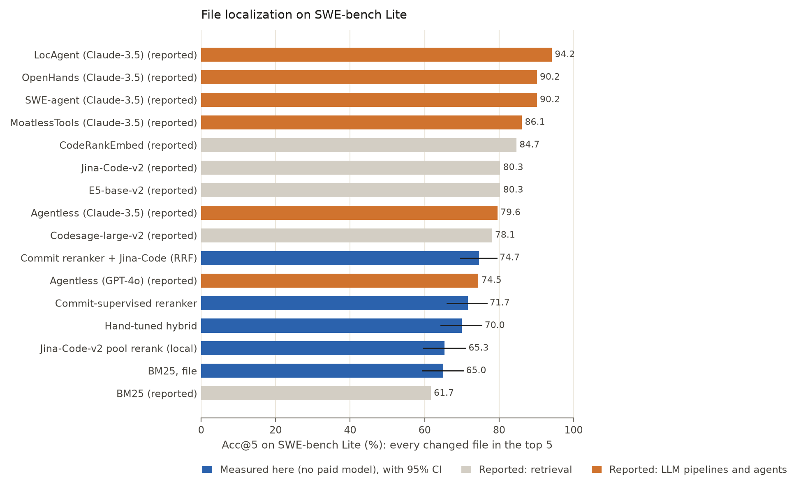
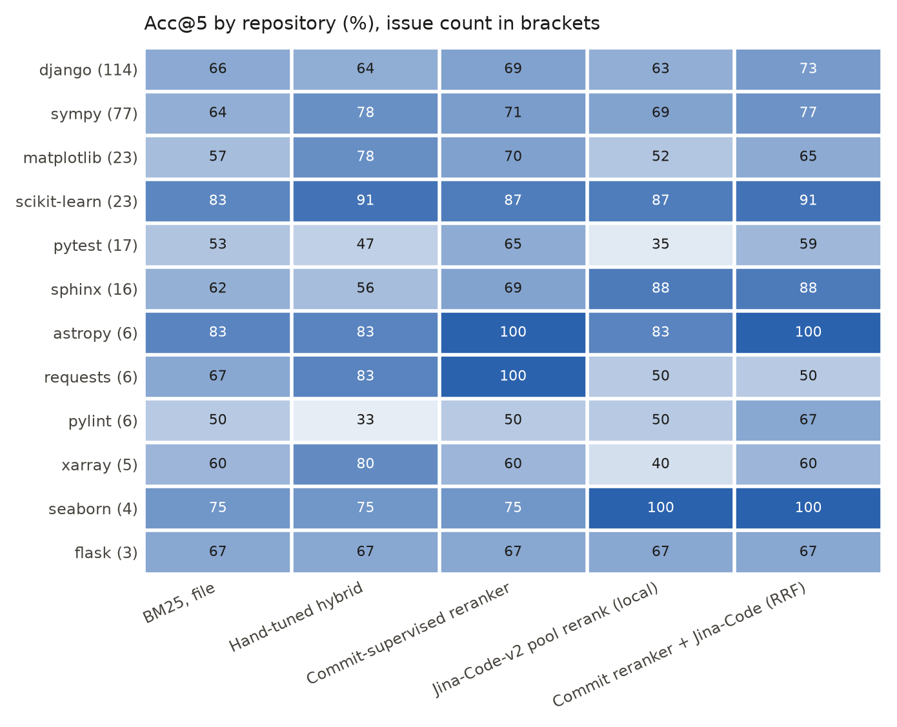
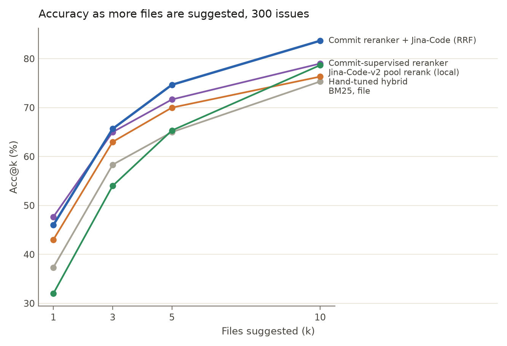

<!-- Generated from docs/RESULTS.template.md by `commitcompass readme`. Edit the template, not this file. -->
# SWE-bench Lite results

File-level localization on all 300 SWE-bench Lite issues. Acc@k (accuracy at k) is 1 when every gold file is inside the top k. MRR (mean reciprocal rank) is 1 divided by the rank of the first gold file.

Measured rows are from this repository. Reported rows are copied from LocAgent: Graph-Guided LLM Agents for Code Localization (arXiv:2503.09089), Table 4 and were not re-run.

| Method | Source | Acc@1 | Acc@3 | Acc@5 | Acc@10 | MRR |
|---|---|---:|---:|---:|---:|---:|
| **Commit reranker ⊕ Jina-Code (RRF)** | measured here | 46.0 [40.3, 51.7] | 65.7 [60.3, 71.0] | 74.7 [69.7, 79.3] | 83.7 | 0.586 |
| BM25 ⊕ Jina-Code (RRF) | measured here | 43.0 [37.3, 48.7] | 63.7 [58.0, 69.3] | 73.3 [68.3, 78.3] | 80.3 | 0.561 |
| Commit-supervised reranker | measured here | 47.7 [42.0, 53.7] | 65.0 [59.3, 70.3] | 71.7 [66.0, 76.7] | 79.0 | 0.587 |
| Commit reranker, leave-one-repo-out | measured here | 46.0 [40.7, 51.7] | 64.3 [58.7, 69.7] | 71.0 [65.7, 76.3] | 79.3 | 0.573 |
| Hand-tuned hybrid | measured here | 43.0 [37.3, 48.3] | 63.0 [57.3, 68.0] | 70.0 [64.3, 75.3] | 76.3 | 0.551 |
| Jina-Code-v2 pool rerank (local) | measured here | 32.0 [26.7, 37.7] | 54.0 [48.3, 59.7] | 65.3 [59.7, 71.0] | 78.7 | 0.469 |
| BM25, file | measured here | 37.3 [32.0, 42.7] | 58.3 [52.7, 64.0] | 65.0 [59.3, 70.3] | 75.3 | 0.507 |
| BM25, chunk-max | measured here | 35.3 [30.0, 41.0] | 57.0 [51.3, 62.7] | 65.0 [59.7, 70.3] | 72.3 | 0.489 |
| BM25 | reported, sparse retrieval | 38.7 | 51.8 | 61.7 | – | – |
| E5-base-v2 | reported, dense retrieval | 49.6 | 74.5 | 80.3 | – | – |
| Jina-Code-v2 | reported, dense retrieval | 43.4 | 71.2 | 80.3 | – | – |
| Codesage-large-v2 | reported, dense retrieval | 47.8 | 69.3 | 78.1 | – | – |
| CodeRankEmbed | reported, dense retrieval | 52.5 | 77.7 | 84.7 | – | – |
| Agentless (GPT-4o) | reported, LLM pipeline | 67.2 | 74.5 | 74.5 | – | – |
| Agentless (Claude-3.5) | reported, LLM pipeline | 72.6 | 79.2 | 79.6 | – | – |
| SWE-agent (Claude-3.5) | reported, LLM agent | 77.4 | 87.2 | 90.2 | – | – |
| OpenHands (Claude-3.5) | reported, LLM agent | 76.3 | 89.8 | 90.2 | – | – |
| MoatlessTools (Claude-3.5) | reported, LLM agent | 72.6 | 85.8 | 86.1 | – | – |
| LocAgent (Claude-3.5) | reported, LLM agent | 77.7 | 92.0 | 94.2 | – | – |

On measured rows, Acc@1, Acc@3, and Acc@5 include a 95% bootstrap confidence interval (CI) over the 300 issues (2,000 resamples). Acc@10 and MRR in that table are means, with no interval. Reported figures are shown to one decimal place.

LLM (large language model) rows in the paper call a paid model. The rows measured here do not.

Blue bars were measured here and include a 95% confidence interval. They do not use a paid model. Fetching the dataset and cloning the repositories does use the network.

## Paired comparisons

Commit-supervised reranker minus BM25: Acc@1 +10.3 pts (95% CI +5.0 to +15.7); Acc@5 +6.7 pts (95% CI +3.0 to +10.7). Leave-one-repo-out minus BM25, at Acc@5: +6.0 pts (95% CI +3.0 to +9.3).

The same tree minus the hand-tuned hybrid (same 18 features, fixed weights): Acc@1 +4.7 pts (95% CI -0.7 to +10.3); Acc@5 +1.7 pts (95% CI -2.3 to +6.0). Both of those intervals include zero.

Fusion minus the tree: Acc@5 +3.0 pts (95% CI -0.7 to +7.0); Acc@1 -1.7 pts (95% CI -6.7 to +3.7). Fusion minus Jina-on-the-pool, at Acc@5: +9.3 pts (95% CI +5.0 to +13.7).

Permutation importance is average precision on the test issues after shuffling one feature. The largest drops are `bm25_file_rrank`, `bm25_chunk_norm`, `recency_log_days`, `bm25_chunk`, `symbol_exact`, `path_frac`.

## Per repository

Counts are uneven: django has 114 issues, flask has 3. A high percentage on a repository with a handful of issues is a thin sample.

| Repository | Issues | BM25, file | Commit-supervised reranker | Jina-Code-v2 pool rerank (local) | Commit reranker ⊕ Jina-Code (RRF) |
|---|---:|---:|---:|---:|---:|
| django/django | 114 | 65.8 | 69.3 | 63.2 | 72.8 |
| sympy/sympy | 77 | 63.6 | 71.4 | 68.8 | 76.6 |
| matplotlib/matplotlib | 23 | 56.5 | 69.6 | 52.2 | 65.2 |
| scikit-learn/scikit-learn | 23 | 82.6 | 87.0 | 87.0 | 91.3 |
| pytest-dev/pytest | 17 | 52.9 | 64.7 | 35.3 | 58.8 |
| sphinx-doc/sphinx | 16 | 62.5 | 68.8 | 87.5 | 87.5 |
| astropy/astropy | 6 | 83.3 | 100.0 | 83.3 | 100.0 |
| psf/requests | 6 | 66.7 | 100.0 | 50.0 | 50.0 |
| pylint-dev/pylint | 6 | 50.0 | 50.0 | 50.0 | 66.7 |
| pydata/xarray | 5 | 60.0 | 60.0 | 40.0 | 60.0 |
| mwaskom/seaborn | 4 | 75.0 | 75.0 | 100.0 | 100.0 |
| pallets/flask | 3 | 66.7 | 66.7 | 66.7 | 66.7 |

## Misses at k = 5

Commit reranker ⊕ Jina-Code (RRF) misses 76 of the 300 issues at k = 5. The categories are mutually exclusive and are assigned in the order written in `categorize_misses`.

| Why Commit reranker ⊕ Jina-Code (RRF) missed at k=5 | Issues | Examples |
|---|---:|---|
| issue names a symbol defined in the gold file | 28 | `django__django-10924`, `django__django-11049`, `django__django-11564` |
| vocabulary gap (gold not in BM25 top 50) | 17 | `django__django-11797`, `django__django-12113`, `django__django-16400` |
| gold file named in issue, still missed | 14 | `django__django-12308`, `django__django-13158`, `django__django-13220` |
| lexically reachable but out-ranked | 11 | `django__django-10914`, `django__django-12470`, `django__django-15388` |
| near miss (ranked 6-10) | 6 | `django__django-13033`, `psf__requests-2674`, `scikit-learn__scikit-learn-13584` |

The top 10 files for every issue are in [`results/swebench_lite_per_instance.jsonl`](../results/swebench_lite_per_instance.jsonl) and on the [explorer](https://vijaychamakuri.github.io/commitcompass/).

## Baselines next to the paper

BM25 in this repo reaches Acc@1 37.3% and Acc@5 65.0%, against 38.7% and 61.7% in the paper. This tokenizer splits camelCase and snake_case and indexes path tokens. The document unit and the issue preprocessing also differ. The gap is left as measured.

Jina here reranks a pool of file skeletons. Pool recall is 91.3%, and Acc@5 is 65.3%. The paper's Jina-Code-v2 row is full-corpus retrieval at Acc@5 80.3%. This run embedded 10,077 file skeletons in about 154 minutes. Full-corpus chunk embedding was not run.

## Efficiency

| | |
|---|---|
| Snapshots replayed | 3,300 |
| Slowest first full index build | 12.7 s |
| django first build | 9.3 s, mean snapshot about 2,578 files |
| Incremental update | 491 ms, 24.2 files re-read |
| Incremental index equals a full rebuild | 17/17 spot-checks |
| Feature computation | 25 ms per query, over all candidate files |

## Commit-history benchmark

1,011 test commits on flask, requests, and httpx. Recall@10 is the share of edited files that appear in the top 10. The masked columns drop words that literally name a gold file.

| Method | Recall@10 | MRR | Recall@10 (file names masked) | MRR (masked) |
|---|---:|---:|---:|---:|
| BM25 (file) | 0.849 | 0.642 | 0.820 | 0.609 |
| Hand-tuned hybrid | 0.893 | 0.725 | 0.855 | 0.650 |
| Commit-supervised reranker | 0.895 | 0.731 | 0.867 | 0.688 |

Paired intervals, the dataset filters, and the per-repo split are in [HISTORY_BENCHMARK.md](HISTORY_BENCHMARK.md).
