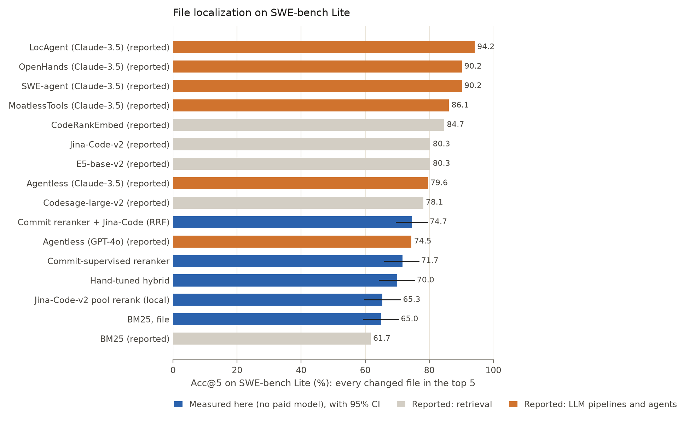
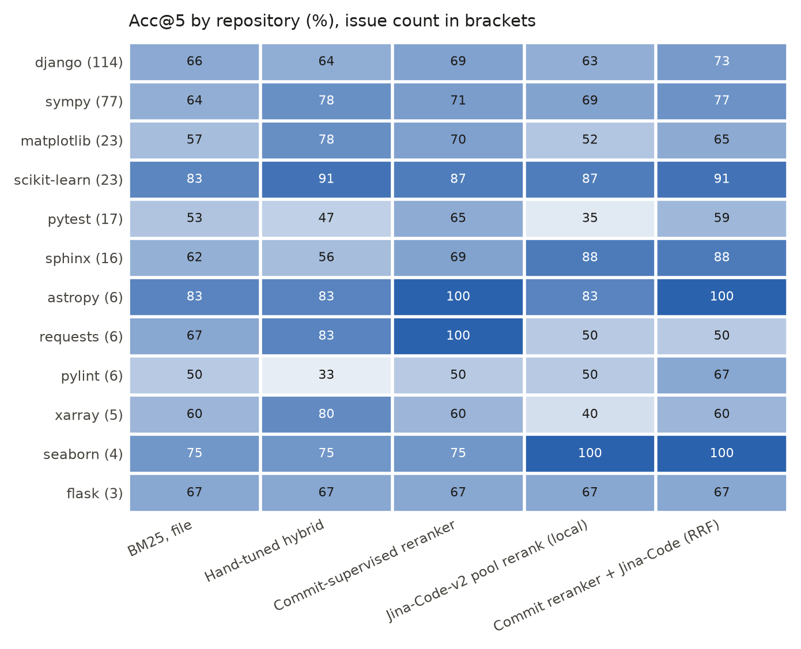
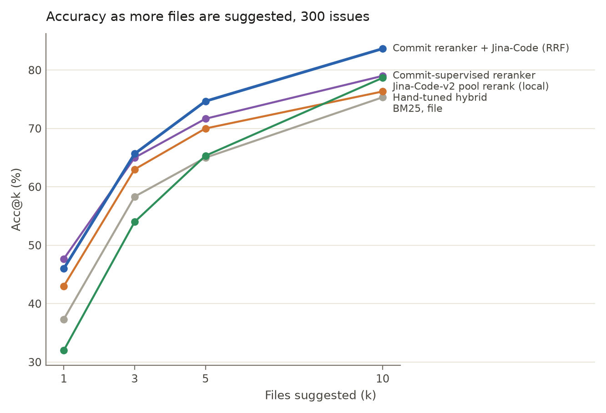

<!-- Generated from docs/RESULTS.template.md by `commitcompass readme`. Edit the template, not this file. -->
# SWE-bench Lite results

File-level localization on all {{n_test}} SWE-bench Lite issues. Acc@k (accuracy at k) is 1 when every gold file is inside the top k. MRR (mean reciprocal rank) is 1 divided by the rank of the first gold file.

Measured rows are from this repository. Reported rows are copied from {{published_source}} and were not re-run.

{{leaderboard}}

On measured rows, Acc@1, Acc@3, and Acc@5 include a 95% bootstrap confidence interval (CI) over the {{n_test}} issues (2,000 resamples). Acc@10 and MRR in that table are means, with no interval. Reported figures are shown to one decimal place.

LLM (large language model) rows in the paper call a paid model. The rows measured here do not.

Blue bars were measured here and include a 95% confidence interval. They do not use a paid model. Fetching the dataset and cloning the repositories does use the network.

## Paired comparisons

Commit-supervised reranker minus BM25: Acc@1 {{d_rr_bm25_acc1}}; Acc@5 {{d_rr_bm25_acc5}}. Leave-one-repo-out minus BM25, at Acc@5: {{d_loro_bm25_acc5}}.

The same tree minus the hand-tuned hybrid (same {{n_features}} features, fixed weights): Acc@1 {{d_rr_hyb_acc1}}; Acc@5 {{d_rr_hyb_acc5}}. Both of those intervals include zero.

Fusion minus the tree: Acc@5 {{d_fused_rr_acc5}}; Acc@1 {{d_fused_rr_acc1}}. Fusion minus Jina-on-the-pool, at Acc@5: {{d_fused_dense_acc5}}.

Permutation importance is average precision on the test issues after shuffling one feature. The largest drops are {{top_features}}.

## Per repository

Counts are uneven: django has 114 issues, flask has 3. A high percentage on a repository with a handful of issues is a thin sample.

{{per_repo_table}}

## Misses at k = 5

{{best_label}} misses {{n_miss}} of the {{n_test}} issues at k = 5. The categories are mutually exclusive and are assigned in the order written in `categorize_misses`.

{{miss_table}}

The top 10 files for every issue are in [`results/swebench_lite_per_instance.jsonl`](../results/swebench_lite_per_instance.jsonl) and on the [explorer](https://vijaychamakuri.github.io/commitcompass/).

## Baselines next to the paper

BM25 in this repo reaches Acc@1 {{bm25_acc1}}% and Acc@5 {{bm25_acc5}}%, against {{pub_bm25_acc1}}% and {{pub_bm25_acc5}}% in the paper. This tokenizer splits camelCase and snake_case and indexes path tokens. The document unit and the issue preprocessing also differ. The gap is left as measured.

Jina here reranks a pool of file skeletons. Pool recall is {{pool_recall}}%, and Acc@5 is {{jina_acc5}}%. The paper's Jina-Code-v2 row is full-corpus retrieval at Acc@5 {{pub_jina_acc5}}%. This run embedded {{dense_files}} file skeletons in about {{dense_min}} minutes. Full-corpus chunk embedding was not run.

## Efficiency

| | |
|---|---|
| Snapshots replayed | {{events}} |
| Slowest first full index build | {{first_build_max}} s |
| django first build | {{django_first}} s, mean snapshot about {{django_files}} files |
| Incremental update | {{incr_ms}} ms, {{reindexed}} files re-read |
| Incremental index equals a full rebuild | {{verified}} spot-checks |
| Feature computation | {{feat_ms}} ms per query, over all candidate files |

## Commit-history benchmark

{{history_n}} test commits on flask, requests, and httpx. Recall@10 is the share of edited files that appear in the top 10. The masked columns drop words that literally name a gold file.

{{history_table}}

Paired intervals, the dataset filters, and the per-repo split are in [HISTORY_BENCHMARK.md](HISTORY_BENCHMARK.md).
